# Noolen — Website Project Brief
**Last updated:** October 30, 2026
**Developer:** Mohammad Alakel
**Project type:** Multi-page · HTML / CSS / JavaScript / GSAP

---

## 1. Brand Overview

**Name:** Noolen
**Name origin:** Derived from "Nool" (நூல்) — Tamil for "thread" or "yarn." The name connects directly to the origin of all textile craft.
**Tagline:** Identity, tailored.
**Industry:** Uniform manufacturing — schools, corporate wear, suits, safety/industrial wear
**Primary market:** Saudi Arabia (schools); secondary: GCC corporate and industrial

**Brand positioning:** The first premium, design-led uniform brand in the Saudi market. Competitors (UNEOM, Zaks, AttireCorp, Stitchcart, MAQ Trading, ABG, Blaze, Genius, Guard Uniforms) compete on price, volume, and certifications. Noolen competes on identity, design craft, and end-to-end service ownership.

---

## 2. Asset Locations on Disk

```
D:\
├── Noolen website\               ← VS Code project root (active development)
│
└── Noolen Material\              ← all source assets (read-only reference)
    ├── Noolen-hero.mp4           ← hero scroll video (merged, final)
    ├── [Satoshi font files]      ← designer-supplied .woff2 files
    │
    ├── Noolen Brand Folder\
    │   └── Logo\
    │       ├── Brand Mark\       ← icon / monogram only
    │       │   ├── JPG\
    │       │   ├── SVG\          ← use these on the website
    │       │   └── PNG\
    │       ├── Primary Logo\     ← wordmark, single line
    │       │   ├── JPG\
    │       │   ├── SVG\
    │       │   └── PNG\
    │       ├── Secondary Logo\   ← wordmark, stacked (2-line)
    │       │   ├── JPG\
    │       │   ├── SVG\
    │       │   └── PNG\
    │       └── Logo with tagline\ ← full lockup incl. "Identity, tailored."
    │           ├── JPG\
    │           ├── SVG\
    │           └── PNG\
    │
    └── Noolen\
        └── Products\
            └── Logo Edited Products\   ← 5 final garment PNGs (logo composited)
```

> **Rule:** Always use **SVG** for logos on the website. Use PNG only for image compositing or cases where SVG is not available.

---

## 3. Recommended Project Folder Structure

```
D:\Noolen website\
├── index.html
├── collections.html
├── about.html
├── custom.html
├── contact.html
├── NOOLEN_PROJECT_BRIEF.md         ← this file
│
├── assets/
│   ├── video/
│   │   └── Noolen-hero.mp4
│   │
│   ├── fonts/
│   │   ├── Satoshi-Regular.woff2
│   │   ├── Satoshi-Medium.woff2
│   │   └── Satoshi-Bold.woff2
│   │
│   ├── logo/
│   │   ├── noolen-wordmark-dark.svg       ← Primary Logo, dark
│   │   ├── noolen-wordmark-cream.svg      ← Primary Logo, cream
│   │   ├── noolen-stacked-dark.svg        ← Secondary Logo, dark
│   │   ├── noolen-stacked-cream.svg       ← Secondary Logo, cream
│   │   ├── noolen-mark-dark.svg           ← Brand Mark, dark
│   │   ├── noolen-mark-light.svg          ← Brand Mark, light
│   │   ├── noolen-lockup-dark.svg         ← Logo with tagline, dark
│   │   └── noolen-lockup-cream.svg        ← Logo with tagline, cream
│   │
│   └── products/
│       ├── polo.png
│       ├── dress-shirt.png
│       ├── blazer.png
│       ├── school-uniform.png
│       └── industrial.png
│
├── css/
│   ├── base.css           ← CSS variables, reset, @font-face, typography scale
│   ├── nav.css            ← shared nav (all pages)
│   ├── footer.css         ← shared footer (all pages)
│   ├── hero.css           ← scroll film, preloader (index only)
│   ├── products.css       ← swipe track + cards (index preview + collections page)
│   ├── collections.css    ← category filter, product grid (collections page)
│   ├── about.css          ← about page sections
│   ├── custom.css         ← inquiry form (custom order page)
│   └── contact.css        ← contact form + details (contact page)
│
└── js/
    ├── preloader.js       ← preloader fade-out logic
    ├── hero-scroll.js     ← GSAP ScrollTrigger video scrub + text overlays
    ├── product-swipe.js   ← drag-to-scroll for product card track
    └── nav.js             ← mobile nav toggle (all pages)
```

---

## 4. Color Palette

| Name | Role | Hex |
|---|---|---|
| Warm Off-White | Primary background — default page surface | `#fcf6dc` |
| Deep Mahogany | Primary text · logo on light backgrounds | `#311a14` |
| Deep Burgundy | Deliberate accent — contact section surface | `#48020c` |
| Warm Black | Dark section backgrounds (products, about, nav overlay) | `#0f0c0a` |

**Notes:**
- No pure `#000000` — Warm Black `#0f0c0a` has subtle brown undertones that keep it in the same earth-tone family as the rest of the palette.
- Burgundy is a **surface/material color**, not a flat UI accent. It should always carry a fabric dot-texture overlay so it reads as a physical material, not a button color.
- Cream `#fcf6dc` is the default page background throughout all light sections.

### CSS Custom Properties

```css
:root {
  /* Colors */
  --cream:     #fcf6dc;   /* Warm Off-White — primary bg */
  --brown:     #311a14;   /* Deep Mahogany — primary text */
  --burgundy:  #48020c;   /* Deep Burgundy — accent surface */
  --black:     #0f0c0a;   /* Warm Black — dark sections */

  /* Typography */
  --font-display: 'Cormorant Garamond', serif;
  --font-body:    'Satoshi', sans-serif;
}
```

---

## 5. Typography

| Role | Font | Weights | Source |
|---|---|---|---|
| Display / Headings / Editorial | Cormorant Garamond | 400, 700, 400 italic | Google Fonts |
| Body / UI / Nav / Labels | Satoshi | 400, 500, 700 | Designer-supplied (local files) |

### Usage rules
- **Cormorant Garamond** — hero text, section headings, product names, large editorial moments, pull quotes. Letter-spacing: `-0.02em` at display sizes.
- **Satoshi** — nav links, body paragraphs, captions, labels, buttons, meta text, footer. Letter-spacing: `+0.06–0.10em` on uppercase/small-cap labels.

### Loading fonts

```css
/* Satoshi — local (designer-supplied) */
@font-face {
  font-family: 'Satoshi';
  src: url('assets/fonts/Satoshi-Regular.woff2') format('woff2');
  font-weight: 400;
  font-display: swap;
}
@font-face {
  font-family: 'Satoshi';
  src: url('assets/fonts/Satoshi-Medium.woff2') format('woff2');
  font-weight: 500;
  font-display: swap;
}
@font-face {
  font-family: 'Satoshi';
  src: url('assets/fonts/Satoshi-Bold.woff2') format('woff2');
  font-weight: 700;
  font-display: swap;
}
```

```html
<!-- Cormorant Garamond — Google Fonts (in <head>) -->
<link rel="preconnect" href="https://fonts.googleapis.com">
<link href="https://fonts.googleapis.com/css2?family=Cormorant+Garamond:ital,wght@0,400;0,700;1,400&display=swap" rel="stylesheet">
```

---

## 6. Logo System

Four variants, each available in Brand Mark / Primary / Secondary / Logo with Tagline, across JPG, SVG, PNG.

| Variant | Where to use |
|---|---|
| **Brand Mark** | Favicon, app icon, embossed/embroidered details, social media profile picture |
| **Primary Logo** (wordmark, single line) | Nav header, garment chest, main brand applications throughout the site |
| **Secondary Logo** (wordmark, stacked) | Collar tags, square-format applications only |
| **Logo with Tagline** (full lockup) | Footer, formal documents, hero preloader |

**Color rule:**
- Dark logo (`#311a14`) on light/cream backgrounds
- Cream logo (`#fcf6dc`) on dark/mahogany/burgundy backgrounds

**Logo design details:** Custom letterforms with open-ring "o"s and a detached dot positioned to the lower right of the final "n".

---

## 7. Product Images

**Source:** `D:\Noolen Material\Noolen\Products\Logo Edited Products\`

Five final garment images — ghost mannequin style, Noolen wordmark composited on each:

| Card # | Garment | Colorway | Logo |
|---|---|---|---|
| 1 | Polo shirt | Deep mahogany body | Cream wordmark, left chest |
| 2 | Formal dress shirt | White | Mahogany wordmark, chest pocket |
| 3 | Blazer | Deep mahogany | Cream wordmark, left breast pocket |
| 4 | School uniform set | White shirt/polo · near-black skirt/trousers · burgundy tie & striped trim | Mahogany wordmark, left chest |
| 5 | Industrial coverall | Near-black body · burgundy shoulder panels · cream reflective strips | Cream wordmark, left chest |

**On the website:** place garments on the dark `#0f0c0a` background in the product swipe section. Product images should have transparent or removed backgrounds before placing.

---

## 8. Hero Scroll Video

**File:** `Noolen-hero.mp4` (in `D:\Noolen Material\`)
**Duration:** ~10 seconds (two AI-generated scenes merged)
**Aspect ratio:** 16:9 · 1080p
**Audio:** None (mute)

### What it shows

| Scene | Description |
|---|---|
| **Scene 1** | Camera starts on the Noolen wordmark rendered in knitted fabric texture on cream. Zooms continuously into the vertical stroke of the letter "l" until the woven fabric fills the entire frame. |
| **Scene 2** | From the macro fabric close-up, the camera pulls back and tilts to reveal the full deep mahogany polo shirt, small and centered on cream background. |

### Scroll-scrubbing implementation

The video does **not** autoplay. `video.currentTime` is driven directly by GSAP ScrollTrigger scroll progress:

```javascript
ScrollTrigger.create({
  trigger: '#scroll-film',
  start: 'top top',
  end: 'bottom bottom',
  scrub: true,
  onUpdate: (self) => {
    const t = self.progress * video.duration;
    if (Math.abs(video.currentTime - t) > 0.05) {
      video.currentTime = t;
    }
  }
});
```

The section is `height: 350vh` with a `position: sticky` inner container at `height: 100vh`, so scrolling 350vh of content advances the video across its full duration.

### Text overlays (testing)

| Label | Fade in | Fade out |
|---|---|---|
| "From one thread." | 15% scroll | 45% scroll |
| "Every identity." | 58% scroll | 88% scroll |

Both use `mix-blend-mode: difference` so they read on both light and dark frames.

---

## 9. Page Structure

**Language:** English only
**Architecture:** Multi-page — 5 pages

**Global nav links:** Collections · About · Custom Order · Contact

---

### Page 1 — Home (`index.html`)

The brand experience entry point. Not a product catalogue — a cinematic first impression that communicates quality and leads visitors toward the collection.

| # | Section | Background | Content |
|---|---|---|---|
| 1 | **Preloader** | `#fcf6dc` | Logo with tagline centered · fades out after ~1s |
| 2 | **Nav** | Transparent (fixed) | Hidden until scroll past hero · Primary Logo dark left · 4 nav links right |
| 3 | **Scroll film** | `#fcf6dc` | `350vh` sticky · video scrubbed by scroll · text overlays ("From one thread." / "Every identity.") |
| 4 | **Product preview** | `#0f0c0a` | 5 garment cards · horizontal drag/swipe · links to Collections page |
| 5 | **About teaser** | `#0f0c0a` | Large Cormorant heading "From one thread, every identity." · 2-line brand summary · link to About page |
| 6 | **Contact CTA** | `#48020c` | Fabric dot-texture overlay · Logo with tagline · headline "Let's build your identity." · button → Custom Order page |
| 7 | **Footer** | `#311a14` | Secondary Logo cream left · nav links · copyright |

---

### Page 2 — Collections (`collections.html`)

The main product showcase. B2B buyers (school procurement managers, HR teams) come here to browse what's available before reaching out.

| Section | Background | Content |
|---|---|---|
| **Page header** | `#fcf6dc` | Cormorant heading "The collection." · short descriptor |
| **Category filter** | `#fcf6dc` | 3 tabs/pills: All · Schools · Corporate · Industrial |
| **Product grid** | `#fcf6dc` | Garment cards in a responsive grid · each card: image, name, category tag, "Inquire" link |
| **Category callouts** | Alternating `#fcf6dc` / `#0f0c0a` | One featured section per category with a larger image + a few lines about Noolen's approach to that category |
| **CTA banner** | `#48020c` | "Ready to outfit your team?" · button → Custom Order |
| **Footer** | `#311a14` | Same as homepage |

**Product categories and garments:**
- **Schools:** School uniform set (boys + girls), Polo shirt
- **Corporate:** Dress shirt, Blazer, Polo shirt
- **Industrial:** Coverall

---

### Page 3 — About (`about.html`)

The brand story in full. Builds trust for B2B buyers who need to know who they're commissioning from before they place a large order.

| Section | Background | Content |
|---|---|---|
| **Page header** | `#fcf6dc` | Large Cormorant italic heading "From one thread." |
| **Brand origin** | `#fcf6dc` | Name origin (Nool / Tamil for thread) · the founding vision · Saudi manufacturing focus |
| **How it works** | `#0f0c0a` | 4-step process: Submit brief → Design review → Production → Delivery. Each step as a numbered editorial block. |
| **Why Noolen** | `#fcf6dc` | 3 pillars: Design-led (not commodity), End-to-end ownership, Saudi-based. Short copy per pillar. |
| **CTA** | `#48020c` | "Start your order." · button → Custom Order |
| **Footer** | `#311a14` | Same as homepage |

---

### Page 4 — Custom Order (`custom.html`)

Replaces a traditional shop — Noolen's clients commission, they don't add to cart. This page qualifies the lead and collects enough info to issue a quote.

| Section | Background | Content |
|---|---|---|
| **Page header** | `#fcf6dc` | Cormorant heading "Let's build your identity." · short intro explaining the process |
| **Process steps** | `#fcf6dc` | 3 steps: Fill the form → Receive a quote within 48h → Approve and we produce |
| **Inquiry form** | `#0f0c0a` | Fields: Name · Organization · Category (Schools / Corporate / Industrial) · Estimated quantity · Message · Submit button |
| **Footer** | `#311a14` | Same as homepage |

**Form behaviour:** No e-commerce. Submit sends an email (mailto or a simple backend). A confirmation message appears in place of the form on success.

---

### Page 5 — Contact (`contact.html`)

Standalone contact page for direct communication — less structured than the order form.

| Section | Background | Content |
|---|---|---|
| **Page header** | `#fcf6dc` | Cormorant heading "Get in touch." |
| **Contact details** | `#fcf6dc` | WhatsApp/phone · email · location (Saudi Arabia) · optionally a Google Maps embed if showroom exists |
| **Contact form** | `#0f0c0a` | Fields: Name · Email · Message · Submit |
| **Footer** | `#311a14` | Same as homepage |

---

### Anchor points (homepage only)
```
#products   → product preview section
#about      → about teaser section
#contact    → contact CTA section
```

---

## 10. Mobile Strategy

- **One 16:9 video**, CSS `object-fit: cover` handles mobile crop. Logo is centered with generous padding (safe zone approach) — no separate 9:16 render needed.
- Product cards: `flex: 0 0 82vw` on mobile, native touch swipe with `scroll-snap-type: x mandatory`.
- Nav: collapses or hides link labels at narrow widths (TBD).
- All layout units: `clamp()` for font sizes, `min()` for widths, `padding` in `vw`+`px` pairs.

---

## 11. Tech Stack

| Layer | Choice |
|---|---|
| Markup | Semantic HTML5 |
| Styling | CSS custom properties · no framework |
| Animation / scroll | GSAP 3 + ScrollTrigger |
| Video scrubbing | Native `<video>` · `currentTime` |
| Fonts | Satoshi local · Cormorant Garamond Google Fonts |
| Build tool | None — vanilla, no bundler |
| Version control | TBD |

**GSAP CDN (paste before closing `</body>`):**
```html
<script src="https://cdnjs.cloudflare.com/ajax/libs/gsap/3.12.5/gsap.min.js"></script>
<script src="https://cdnjs.cloudflare.com/ajax/libs/gsap/3.12.5/ScrollTrigger.min.js"></script>
```

---

## 12. Design References

| Reference | What it informs |
|---|---|
| [Loomere](https://loomere.higgsfield.app) | Scroll-driven video hero mechanic · pacing |
| Ivory knit cardigan street photo (`clothing.jpg`) | Corporate/casual tone · cream + earth palette in garment styling |
| Navy industrial coverall 3D render (`industrial_clothing.jpg`) | Industrial category positioning |
| Burgundy school blazer AI photo (`school_refrence.jpg`) | School uniform premium direction |
| Dual-mannequin school set photo (`WhatsApp_Image_...jpeg`) | Ghost mannequin product display format |

---

## 13. Key Design Decisions & Rationale

| Decision | Rationale |
|---|---|
| Scroll-driven video (not autoplay) | User controls pace · avoids browser autoplay restrictions · matches Loomere reference |
| `currentTime` scrubbing over frame sequence | Faster to build now · frame sequence (Loomere's method) can be added later for final polish |
| Cormorant Garamond + Satoshi pairing | Satoshi = geometric, precise, modern (manufacturing). Cormorant = editorial, elegant (craft). Together they reflect both sides of the brand identity. |
| Warm Black `#0f0c0a` instead of `#000000` | Keeps the palette tonally consistent — same brown-earth family as mahogany and cream. Pure black would feel cold and disconnected. |
| Burgundy as a textured surface | The color reads as luxurious when applied as a material (with dot/weave texture). As a flat UI color it would read as generic "fashion red". |
| Ghost mannequin product display | Keeps focus on garment quality and construction, not models. Consistent across all 5 categories. |
| Horizontal swipe product cards | Matches premium fashion editorial references. Works on desktop (drag) and mobile (touch swipe). |
| Single 16:9 video, CSS cover for mobile | Center-safe zone means logo stays visible on all crops. Avoids generating a separate 9:16 video. |

---

## 14. Shared Components

These two blocks appear on every page — build them once in their own CSS/JS files and paste the same HTML into each page.

### Nav
```html
<nav id="nav">
  <a href="index.html">
    
  </a>
  <ul>
    <li><a href="collections.html">Collections</a></li>
    <li><a href="about.html">About</a></li>
    <li><a href="custom.html">Custom Order</a></li>
    <li><a href="contact.html">Contact</a></li>
  </ul>
  <button class="nav-toggle" aria-label="Menu">&#9776;</button>
</nav>
```

**Nav behaviour:**
- On the homepage: hidden (opacity 0) until user scrolls past the hero section, then fades in.
- On all other pages: always visible from page load.
- Active page link gets a subtle underline or opacity treatment to show current page.
- Mobile: links collapse behind a hamburger button (`.nav-toggle`); clicking reveals a full-screen or slide-in drawer.

### Footer
```html
<footer>
  
  <nav class="footer-nav">
    <a href="collections.html">Collections</a>
    <a href="about.html">About</a>
    <a href="custom.html">Custom Order</a>
    <a href="contact.html">Contact</a>
  </nav>
  <p>© 2026 Noolen. All rights reserved.</p>
</footer>
```

**Footer background:** `#311a14` (Deep Mahogany) · all text and logos in cream `#fcf6dc`.

---

## 15. HTML Page Shells

Every page shares this `<head>` block — copy it into each file and change only `<title>` and the page-specific CSS link.

```html
<!DOCTYPE html>
<html lang="en">
<head>
  <meta charset="UTF-8">
  <meta name="viewport" content="width=device-width, initial-scale=1, viewport-fit=cover">
  <title>Noolen — [Page Name]</title>

  <!-- Cormorant Garamond -->
  <link rel="preconnect" href="https://fonts.googleapis.com">
  <link href="https://fonts.googleapis.com/css2?family=Cormorant+Garamond:ital,wght@0,400;0,700;1,400&display=swap" rel="stylesheet">

  <!-- Shared CSS -->
  <link rel="stylesheet" href="css/base.css">
  <link rel="stylesheet" href="css/nav.css">
  <link rel="stylesheet" href="css/footer.css">

  <!-- Page-specific CSS -->
  <link rel="stylesheet" href="css/[page].css">
</head>
<body>

  <!-- Nav (shared) -->

  <!-- Page content -->

  <!-- Footer (shared) -->

  <!-- GSAP (only on pages that use it) -->
  <script src="https://cdnjs.cloudflare.com/ajax/libs/gsap/3.12.5/gsap.min.js"></script>
  <script src="https://cdnjs.cloudflare.com/ajax/libs/gsap/3.12.5/ScrollTrigger.min.js"></script>

  <!-- Shared JS -->
  <script src="js/nav.js"></script>

  <!-- Page-specific JS -->
  <script src="js/[page].js"></script>
</body>
</html>
```

---

## 16. Build Order

Build in this sequence so shared pieces are done before pages that depend on them:

1. **`css/base.css`** — CSS variables, reset, `@font-face` for Satoshi, typography scale
2. **`css/nav.css` + `js/nav.js`** — shared nav with mobile toggle
3. **`css/footer.css`** — shared footer
4. **`index.html`** — homepage: preloader → scroll film → product preview → about teaser → contact CTA
5. **`css/hero.css` + `js/hero-scroll.js` + `js/preloader.js`** — hero video scrub and overlays
6. **`css/products.css` + `js/product-swipe.js`** — swipe track (shared between index and collections)
7. **`collections.html` + `css/collections.css`** — full product grid with category filter
8. **`about.html` + `css/about.css`** — brand story and process steps
9. **`custom.html` + `css/custom.css`** — inquiry form
10. **`contact.html` + `css/contact.css`** — contact details and form

---

## 18. Open Questions / TBD

- [ ] Exact Satoshi font filenames (as they appear in `D:\Noolen Material\`)
- [ ] Exact logo filenames (as they appear in the Brand Folder subfolders)
- [ ] Exact product image filenames (as they appear in `Logo Edited Products`)
- [ ] CTA button text and destination for contact section
- [ ] Nav behaviour on mobile (hamburger? slide-in drawer?)
- [ ] Domain name
- [ ] Nav mobile behaviour (hamburger menu? slide-in drawer?)
- [ ] Form submission method — mailto vs. backend (EmailJS, Formspree, or server-side)
- [ ] Whether a showroom/physical address exists for the Contact page map
- [ ] Arabic version — not in current scope, revisit later
